# Planejamento dos Slides: Oráculos em Blockchain

> **Objetivo Obrigatório da Aula**: Compreender como aplicações blockchain utilizam dados externos de forma confiável.  
> **Estrutura de Apresentação**: Modo Instrutor em Tela Cheia (*Fullscreen Slide Deck*), com linha temporal minimalista de progresso no topo e slides visuais limpos e diretos para projeção aos alunos.

---

## Linha Temporal de Aprendizado (9 Slides)

```mermaid
flowchart LR
    S1["1. Por que On-Chain é Isolado?"] --> S2["2. O Desastre da Chamada Direta"]
    S2 --> S3["3. O que é um Oráculo?"]
    S3 --> S4["4. Redes Descentralizadas (DONs)"]
    S4 --> S5["5. Tipos de Oráculos"]
    S5 --> S6["6. The Oracle Problem"]
    S6 --> S7["7. Como Prevenir o Problema?"]
    S7 --> S8["8. Aplicações Práticas"]
    S8 --> S9["9. Síntese da Confiabilidade"]
```



---

## Especificação dos Slides para Projeção

---

### Slide 1: Por que Redes On-Chain são Isoladas da Web 2?
**Posição na Timeline**: `[ ● ○ ○ ○ ○ ○ ○ ○ ○ ]` (1 / 9)

#### 🖥️ Conteúdo do Slide:
* **Título**: O Isolamento da Blockchain: A Caixa-Preta On-Chain
* **Diagrama Esquemático**:
  ```
  ┌─────────────────────────┐               ┌─────────────────────────┐
  │      MUNDO EXTERIOR     │               │   AMBIENTE ON-CHAIN     │
  │         (Web 2)         │               │     (EVM / Nós)         │
  │                         │       ❌      │                         │
  │ • APIs REST & Websites  │   BLOQUEADO   │ • Execução 100% Fechada │
  │ • Bancos de Dados       │  POR DESIGN   │ • Sem Acesso à Internet │
  │ • Cotações & Câmbio     │               │ • Sem 'fetch', 'curl'   │
  └─────────────────────────┘               └─────────────────────────┘
  ```
* **Pontos-Chave**:
  * **O Imperativo do Determinismo**: Todo computador da rede descentralizada precisa chegar exatamente ao mesmo resultado executando o mesmo código.
  * **Ausência de Conexão Externa**: Smart contracts não possuem capacidade nativa de disparar requisições de rede.
  * **Reprodutibilidade Histórica**: Qualquer nó que sincronizar a rede daqui a anos deve reconstruir os blocos sem depender de serviços externos estarem online.
* **Mensagem-Chave**: *A blockchain é intencionalmente isolada para que o consenso nunca seja corrompido por instabilidades externas.*

---

### Slide 2: O Desastre da Chamada Direta (O Caso do Dólar)
**Posição na Timeline**: `[ ● ● ○ ○ ○ ○ ○ ○ ○ ]` (2 / 9)

#### 🖥️ Conteúdo do Slide:
* **Título**: O Experimento do Dólar: A Quebra do Consenso
* **Diagrama Esquemático**:
  ```
                       [ API Externa: preco-dolar.com ]
                               /       |       \
                   Latência: 15ms    60ms     140ms
                             /         |         \
              [Nó Brasil]        [Nó EUA]        [Nó Japão]
               USD = 5,4001      USD = 5,4018     USD = 5,4042
                     \                 |                 /
                      \________________|________________/
                                       ⚠️
                         ESTADOS FINAIS DIVERGENTES
                  Validadores Discordam -> Rede Quebrada (Fork)
  ```
* **Pontos-Chave**:
  * **Assincronia e Latência Global**: O tempo de resposta de uma chamada de rede varia conforme a distância física e rotas de tráfego de cada nó.
  * **Volatilidade em Milissegundos**: Preços de mercado mudam constantemente; pequenas frações de segundo produzem valores distintos.
  * **Destruição do Estado Único**: Se validadores registram cotações diferentes para uma mesma transação, o consenso quebra e a blockchain se divide.
* **Mensagem-Chave**: *Se cada nó consultasse a internet diretamente, seria impossível haver um acordo sobre o estado da rede.*

---

### Slide 3: O que é um Oráculo e Como Funciona?
**Posição na Timeline**: `[ ● ● ● ○ ○ ○ ○ ○ ○ ]` (3 / 9)

#### 🖥️ Conteúdo do Slide:
* **Título**: O Oráculo: A Inversão do Fluxo de Informação
* **Diagrama Esquemático**:
  ```
  [ MUNDO OFF-CHAIN ]                        [ MUNDO ON-CHAIN ]
   Fontes Web 2 / APIs                        Smart Contract Consumidor
          │                                              ▲
          │ (1. Consulta externa)                        │ (3. Consulta interna)
          ▼                                              │
   ┌──────────────┐    2. Transação Assinada    ┌─────────────────┐
   │ AGENTE       │ ──────────────────────────> │ CONTRATO DO     │
   │ ORÁCULO      │   (Dado entra no Bloco)     │ FEED DE DADOS   │
   └──────────────┘                             └─────────────────┘
  ```
* **Pontos-Chave**:
  * **A Ponte de Conexão**: Um oráculo é uma entidade que lê dados do mundo exterior e os grava dentro da blockchain.
  * **Inversão do Fluxo (Push, não Pull)**: A blockchain não busca o dado fora; o oráculo "empurra" o dado para dentro através de uma transação assinada.
  * **Por que Funciona?**: Uma vez minerado no bloco, o dado torna-se parte do estado compartilhado, estático e determinístico para todos os validadores.
* **Mensagem-Chave**: *O oráculo não dá acesso à internet ao contrato; ele registra na blockchain uma cópia assinada do fato externo.*

---

### Slide 4: Quem e Como Faz? Redes Descentralizadas (DONs)
**Posição na Timeline**: `[ ● ● ● ● ○ ○ ○ ○ ○ ]` (4 / 9)

#### 🖥️ Conteúdo do Slide:
* **Título**: Redes Descentralizadas de Oráculos (DONs)
* **Diagrama Esquemático**:
  ```
  FONTES EXTERNAS        NÓS ORÁCULOS INDEPENDENTES          CONSENSO OFF-CHAIN
  [Exchange A] \         /─> [ Nó 1: $100 ] ─\
  [Exchange B] ── Consultas ─> [ Nó 2: $101 ] ──+──> [ AGREGAÇÃO: MEDIANA ]
  [Exchange C] /         \─> [ Nó 3: $100 ] ─/             Valor Final: $100
                         \─> [ Nó Falho: $400 ]─X        (Gravado On-Chain)
  ```
* **Pontos-Chave**:
  * **Quem Opera?**: Redes formadas por dezenas de operadores de nós independentes (ex: Chainlink, Pyth Network).
  * **Diversidade de Coleta**: Cada operador consulta múltiplos fornecedores de dados de forma independente.
  * **Consenso Off-Chain por Mediana**: Os nós comparam as leituras entre si, eliminam discrepâncias extremas (*outliers*) e encontram a mediana matemática.
  * **Publicação Consolidada**: O valor final agregado é assinado criptograficamente e enviado à rede em uma transação única.
* **Mensagem-Chave**: *A descentralização no nível dos oráculos elimina a dependência de um servidor único de informação.*

---

### Slide 5: Os Diferentes Tipos de Oráculos
**Posição na Timeline**: `[ ● ● ● ● ● ○ ○ ○ ○ ]` (5 / 9)

#### 🖥️ Conteúdo do Slide:
* **Título**: Taxonomia dos Oráculos
* **Diagrama Esquemático**:
  ```
  ┌────────────────────────────────────────────────────────────────────────┐
  │                           DIREÇÃO DO FLUXO                             │
  │ • Inbound (Entrada)  : Mundo Real ───> Blockchain (Preços, Clima)      │
  │ • Outbound (Saída)   : Blockchain ───> Mundo Real (Pagamentos, Portas) │
  ├────────────────────────────────────────────────────────────────────────┤
  │                            FONTE DO DADO                               │
  │ • Software           : APIs, Web Services, Cotações Digitais           │
  │ • Hardware           : Sensores IoT, Leitores RFID, Câmeras            │
  ├────────────────────────────────────────────────────────────────────────┤
  │                        MODELO DE CONFIANÇA                             │
  │ • Centralizado       : 1 Ponto / 1 Empresa (Rápido, Risco Crítico)     │
  │ • Descentralizado    : Múltiplos Nós + Agregação (Seguro, Padrão Web3) │
  └────────────────────────────────────────────────────────────────────────┘
  ```
* **Pontos-Chave**:
  * **Inbound vs. Outbound**: Alimentar decisões de contratos inteligentes ou acionar reações e dispositivos no mundo real.
  * **Software vs. Hardware**: Leitura de dados estritamente digitais versus monitoramento de eventos físicos da cadeia de suprimentos.
  * **Centralizado vs. Descentralizado**: A escolha determinante entre simplicidade técnica e resiliência de segurança.
* **Mensagem-Chave**: *A arquitetura do oráculo varia conforme o tipo de informação necessária e a direção da interação.*

---

### Slide 6: O "Problema dos Oráculos" (The Oracle Problem)
**Posição na Timeline**: `[ ● ● ● ● ● ● ○ ○ ○ ]` (6 / 9)

#### 🖥️ Conteúdo do Slide:
* **Título**: O "Problema dos Oráculos": O Dilema da Confiança
* **Diagrama Esquemático**:
  ```
  DADO EXTERNO                ORÁCULO               SMART CONTRACT
  (Falho ou Manipulado)    (Ponto Crítico)       (Execução Imutável)
       ⚠️
  ┌─────────────┐          ┌─────────────┐       ┌──────────────────────┐
  │ DADO FALSO  │ ───────> │ REPASSA     │ ────> │ EXECUTA A MENTIRA    │
  │ OU ADULTERADO│          │ O VALOR     │       │ DE FORMA IRREVERSÍVEL│
  └─────────────┘          └─────────────┘       └──────────────────────┘
                   GARBAGE IN  ═══════════════>  GARBAGE OUT
  ```
* **Pontos-Chave**:
  * **O Paradoxo da Segurança**: A blockchain garante que o código executará sem falhas, mas não tem como saber se o dado fornecido é verdadeiro.
  * **Garbage In, Garbage Out**: Se um oráculo injetar uma informação errada ou corrompida, o contrato inteligente executará o erro com precisão matemática e irreversível.
  * **O Elo Mais Fraco**: O oráculo torna-se o principal vetor de ataque em aplicações Web3 (hacks bilionários por manipulação de preço).
* **Mensagem-Chave**: *A segurança de um contrato inteligente é limitada à qualidade e integridade dos dados que ele consome.*

---

### Slide 7: Como Prevenir o Problema dos Oráculos?
**Posição na Timeline**: `[ ● ● ● ● ● ● ● ○ ○ ]` (7 / 9)

#### 🖥️ Conteúdo do Slide:
* **Título**: Estratégias de Mitigação e Defesa em Profundidade
* **Diagrama Esquemático**:
  ```
                   CAMADAS DE PROTEÇÃO CONTRA FALHAS
  
  [ 1. MULTIFONTES ]        Dezenas de exchanges e APIs primárias agregadas.
         │
  [ 2. MEDIANA OFFLINE ]    Descarte de outliers (valores manipulados são ignorados).
         │
  [ 3. STAKING & SLASHING ] Operadores perdem dinheiro se reportarem dados falsos.
         │
  [ 4. TRAVAS ON-CHAIN ]    • Checagem de Frescor (Rejeitar dados 'stale' antigos).
                            • Circuit Breakers (Bloqueio se variação for anormal).
                            • TWAP (Preço médio ponderado no tempo contra ataques relâmpago).
  ```
* **Pontos-Chave**:
  * **Agregação em Múltiplas Camadas**: Nunca depender de uma única API, de uma única corretora ou de um único operador de nó.
  * **Filtros Estatísticos Robustos**: O uso da mediana matemática expurga tentativas individuais de manipulação súbita.
  * **Incentivos Econômicos**: Operadores apostam garantias de valor financeiro (*staking*) que são confiscadas (*slashing*) em caso de fraude.
  * **Verificações Defensivas no Contrato**: O código do contrato inteligente deve validar ativamente o tempo da última atualização e impor limites de tolerância.
* **Mensagem-Chave**: *A prevenção combina descentralização econômica fora da cadeia com regras de validação rigorosas dentro do contrato.*

---

### Slide 8: Aplicações Práticas: Feeds, Automações e Conectores
**Posição na Timeline**: `[ ● ● ● ● ● ● ● ● ○ ]` (8 / 9)

#### 🖥️ Conteúdo do Slide:
* **Título**: Oráculos em Ação no Ecossistema Web3
* **Diagrama Esquemático**:
  ```
  1. PRICE FEEDS (DeFi)
     • Protocolos de Empréstimo: Verificação contínua do valor de colateral (ex: Aave).
     • Stablecoins: Manutenção de paridade com moedas fiat e reservas garantidas.

  2. AUTOMAÇÕES / KEEPERS
     • Contratos inteligentes não executam tarefas sozinhos sem uma transação.
     • Robôs de oráculos monitoram condições off-chain e disparam liquidações ou colheitas.

  3. ALEATORIEDADE E CONECTORES CUSTOMIZADOS
     • Jogos & NFTs: Geração de números aleatórios com prova criptográfica verificável (VRF).
     • Seguros Paramétricos: Pagamento automático baseado em dados climáticos ou voos.
  ```
* **Pontos-Chave**:
  * **Alimentação Contínua de Mercado**: Dados atualizados e disponíveis sob demanda para o ecossistema financeiro descentralizado.
  * **Execução Autônoma de Contratos**: Superação da limitação da EVM por meio de gatilhos automáticos executados por oráculos.
  * **Conexão com a Economia Real**: Viabilização de novos modelos de negócios que dependem de dados do mundo físico.
* **Mensagem-Chave**: *Oráculos são a infraestrutura invisível que transforma contratos estáticos em aplicações dinâmicas do mundo real.*

---

### Slide 9: Síntese: Como Aplicações Consomem Dados com Confiabilidade
**Posição na Timeline**: `[ ● ● ● ● ● ● ● ● ● ]` (9 / 9)

#### 🖥️ Conteúdo do Slide:
* **Título**: A Fórmula da Confiabilidade em Dados Externos
* **Diagrama Esquemático**:
  ```
  COMO A BLOCKCHAIN GARANTE DADOS CONFIÁVEIS?
  
  ┌──────────────────────┐    ┌──────────────────────┐    ┌──────────────────────┐
  │     DIVERSIDADE      │    │       CONSENSO       │    │      VERIFICAÇÃO     │
  │     DE FONTES        │    │    CRIPTOGRÁFICO     │    │       DEFENSIVA      │
  │                      │ ─> │                      │ ─> │                      │
  │ Dezenas de provedores│    │ Múltiplos nós,       │    │ Contrato valida      │
  │ sem controle único   │    │ mediana e staking    │    │ frescor e limites    │
  └──────────────────────┘    └──────────────────────┘    └──────────────────────┘
                                         │
                                         ▼
                 [ DADOS EXTERNOS CONFIÁVEIS E AUDITÁVEIS ]
  ```
* **Pontos-Chave**:
  * **Confiança Sem Dependência de Entidade Única**: A confiabilidade decorre de consenso criptoeconômico, e não da fé em uma autoridade central.
  * **Eliminação de Pontos de Falha**: Redes distribuídas tornam custos de corrupção ou ataque economicamente inviáveis.
  * **Dados Determinísticos e Verificáveis**: O dado entra em uma transação pública, transparente e passível de auditoria por qualquer usuário.
* **Mensagem-Chave**: *Aplicações blockchain usam dados externos com segurança combinando agregação descentralizada, garantias econômicas e validação on-chain.*

---

## Estrutura de Apresentação Recomendada para a Interface

1. **Ativação**: Clique no botão "Modo Instrutor" no canto superior direito.
2. **Visual**: Tela cheia sem menus ou botões volumosos.
3. **Indicador Superior**: Barra discreta com 9 pontos de progresso e título do slide ativo.
4. **Navegação**: Teclas de seta (`←` / `→`), barra de espaço para avançar, ou clique nos pontos da linha temporal; tecla `Esc` para retornar à plataforma.
